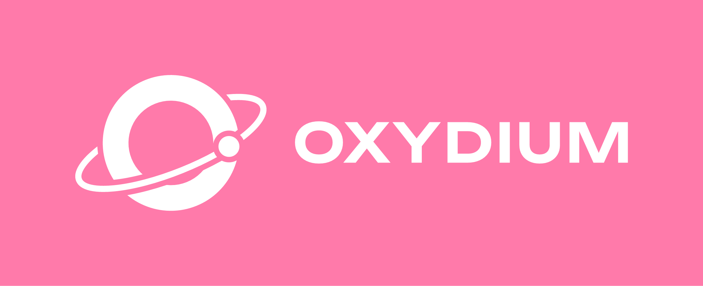

  

  A small team making apps for gamers and Discord. 
  <a href="https://discord.gg/aaFqzuJFuS">Discord server</a> ·
  <a href="https://github.com/iraqies/oxydium/releases">Downloads</a>

## Projects

###  OxyCord

Add playtime to the games on your Discord profile. Pick the games, pick the hours, and OxyCord does the rest.

1. Sign in with Discord. You log in on discord.com itself, never in a form of ours.
2. Choose how many games and how many hours, up to 400 per game.
3. Press claim, and the hours show up on your profile.

Several accounts in one app, English and Arabic, and your login is kept in your device's secure storage.

**[Download OxyCord](https://github.com/iraqies/oxydium/releases/latest)**

| System | File |
| --- | --- |
| Windows | `OxyCord-Setup-<version>.exe` (installer) or `OxyCord-<version>-windows-x64.zip` |
| macOS 12+ | `OxyCord-<version>.dmg` (Apple silicon and Intel) |
| Linux | `OxyCord-<version>-amd64.deb` or `OxyCord-<version>-x86_64.flatpak` |
| Android 7+ | `OxyCord-<version>.apk` (every phone) or `OxyCord-<version>-arm64.apk` (smaller, 64-bit phones) |

Install steps for each system are in the notes of every release.

OxyCord is made by Oxydium and isn't affiliated with Discord.
